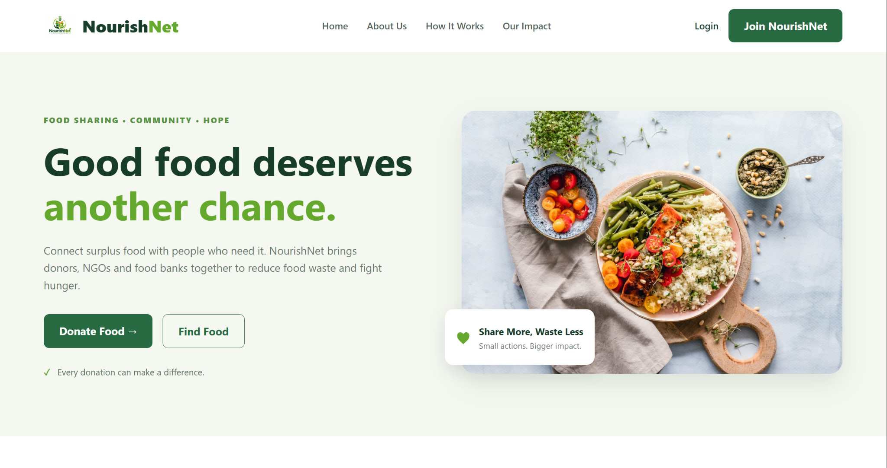

# NourishNet – Food Donation & Distribution Management System

**Connecting surplus food with people in need.**

NourishNet is a Django-based web application that connects food donors with NGOs and food banks. It helps ensure surplus food reaches people in need instead of going to waste.

Donors can list surplus food with details such as quantity, food type, location and use-by time. NGOs can discover and reserve available donations, while administrators manage users, donations and reservations through a central dashboard.

## Live Demo

- **Live Website:** https://fidasfathima12.pythonanywhere.com/
- **GitHub Repository:** https://github.com/fidasfathima79-netizen/NourishNet

## Screenshots

### Homepage


### Authentication
| Login | Registration |
|---|---|
|  |  |

### Dashboards
| Admin Dashboard | Donor Dashboard |
|---|---|
|  |  |

### NGO Dashboard


### Donation and Reservation Management
| Available Donations | Reservations |
|---|---|
|  |  |

## Features

| Requirement | Implementation |
|---|---|
| User Authentication | Registration, login and logout using a custom Django User model |
| Role-Based Access Control | Admin, Donor and NGO roles |
| CRUD Operations | Create, view, edit and delete donor-owned donations |
| Database Management | SQLite, Django migrations and foreign-key relationships |
| Dashboards | Separate Admin, Donor and NGO dashboards with statistics |
| Responsive UI | HTML, CSS, Bootstrap 5 and media queries |
| Django Admin | User, Donation and Reservation management |
| Search and Filtering | Search by food, location and donor, with food-type filtering |
| File Uploads | Food photographs uploaded with donations |
| REST-Style API | JSON endpoint: `GET /api/donations/?q=&food_type=` |

## User Roles

| Role | Permissions |
|---|---|
| **Admin** | Manage users, donations and reservations; access the admin dashboard and Django admin |
| **Donor** | Create, edit and delete own donations; view reservations and mark pickups as collected |
| **NGO** | Browse and search available donations, reserve food and track reservations |

All protected pages require authentication. Administrative pages are restricted by role.

## Technology Stack

- **Backend:** Python, Django
- **Frontend:** HTML, CSS, Bootstrap 5, JavaScript
- **Database:** SQLite
- **Image Handling:** Pillow
- **Deployment:** PythonAnywhere
- **Version Control:** Git and GitHub

## Project Structure

```text
NourishNet/
├── manage.py
├── requirements.txt
├── config/
├── core/
│   └── management/
│       └── commands/
│           └── seed_demo.py
├── templates/
│   ├── accounts/
│   ├── admin/
│   ├── donor/
│   ├── ngo/
│   └── donations/
├── static/
├── media/
└── screenshots/
```

## Local Installation and Setup

### 1. Clone the repository

```bash
git clone https://github.com/fidasfathima79-netizen/NourishNet.git
cd NourishNet
```

### 2. Create a virtual environment

```bash
python -m venv venv
```

Activate it:

**Windows**
```bash
venv\Scripts\activate
```

**Linux / macOS**
```bash
source venv/bin/activate
```

### 3. Install dependencies

```bash
pip install -r requirements.txt
```

### 4. Apply migrations

```bash
python manage.py migrate
```

### 5. Create demo accounts (optional)

```bash
python manage.py seed_demo
```

### 6. Start the development server

```bash
python manage.py runserver
```

Open: http://127.0.0.1:8000/

## Useful Django Commands

```bash
python manage.py runserver
python manage.py migrate
python manage.py seed_demo
python manage.py test
python manage.py createsuperuser
python manage.py collectstatic
```

## Deployment

NourishNet is deployed using **PythonAnywhere**.

Deployment includes:

1. Cloning the GitHub repository.
2. Creating a Python virtual environment.
3. Installing project dependencies.
4. Configuring the Django WSGI application.
5. Setting production environment variables.
6. Applying database migrations.
7. Collecting static files.
8. Reloading the web application.

## Future Improvements

- Email notifications for donation reservations.
- Location-based donation discovery.
- Food expiry alerts.
- Improved analytics and impact reports.
- Integration with maps for food collection locations.

## Project Links

- **GitHub:** https://github.com/fidasfathima79-netizen/NourishNet
- **Live Application:** https://fidasfathima12.pythonanywhere.com/

---

**NourishNet – Share More, Waste Less.**
