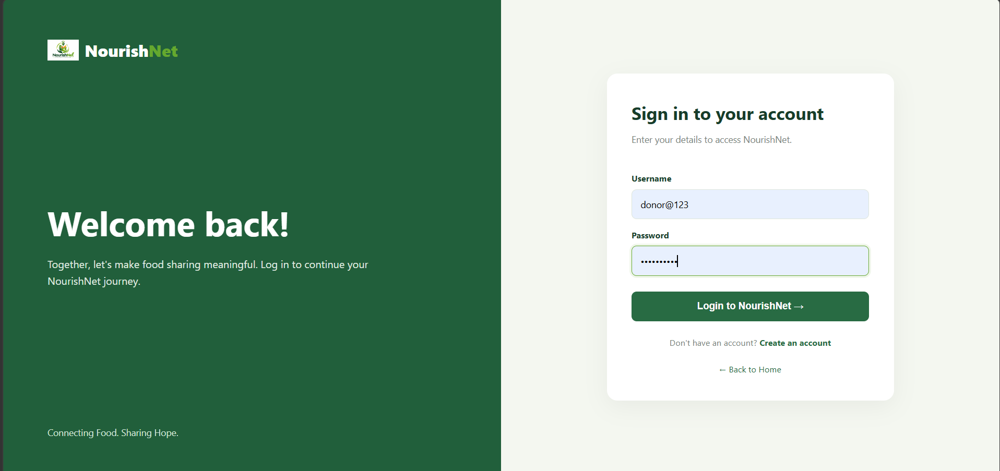
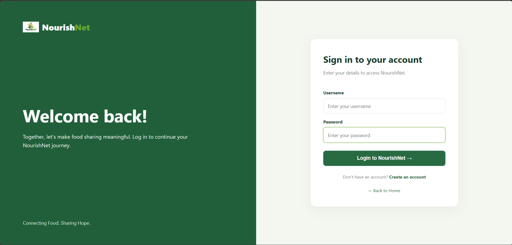
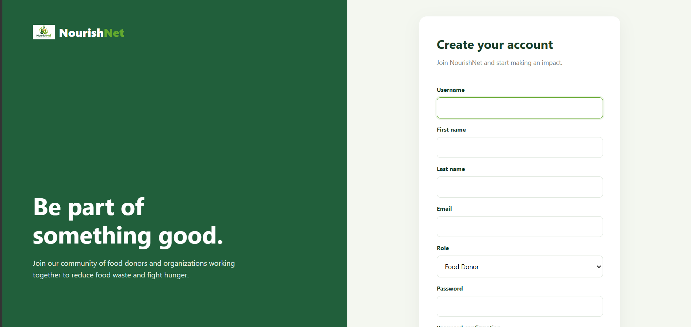
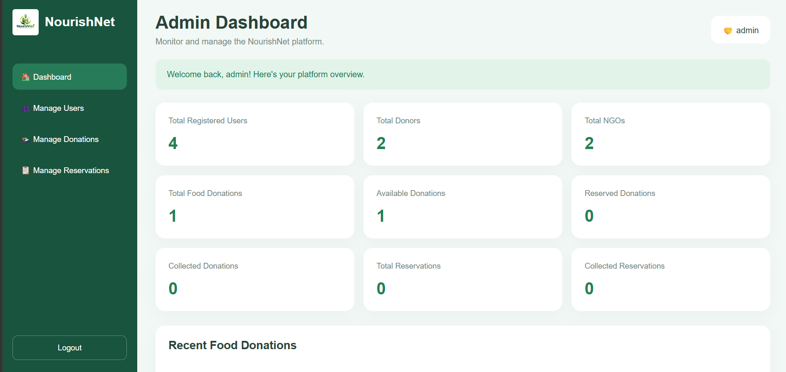
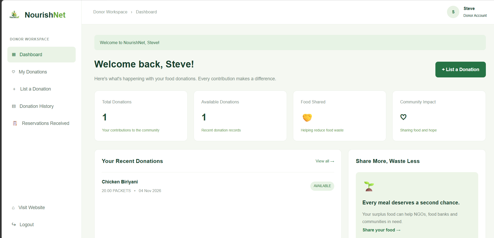
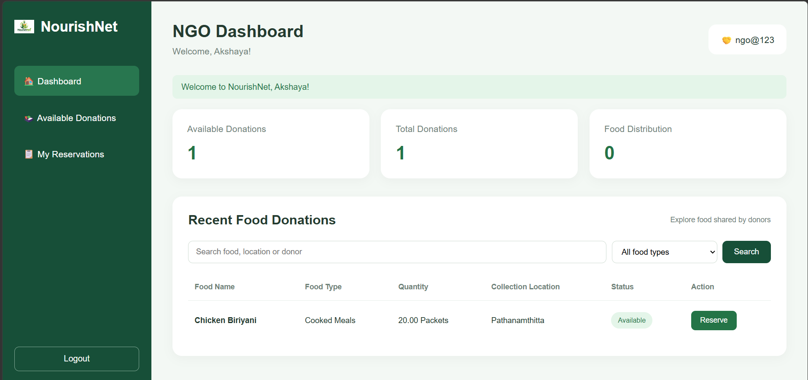
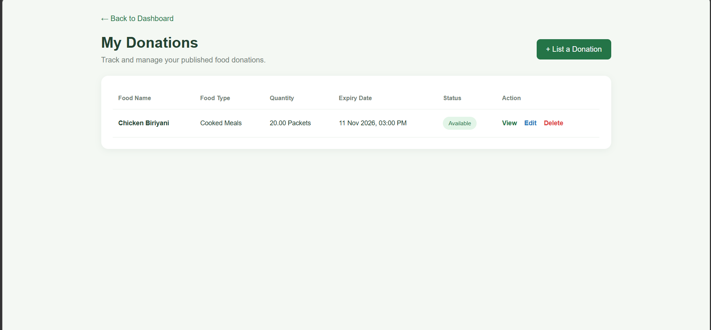
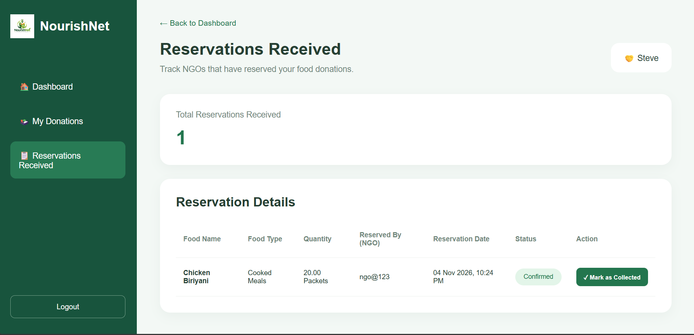

# NourishNet – Food Donation & Distribution Management System

**NourishNet** is a Django-based web application that connects food donors with NGOs to reduce food waste and improve food distribution. It allows donors to share surplus food and enables NGOs to reserve and collect available donations.

🌐 **Live Demo:** https://fidasfathima12.pythonanywhere.com/  
💻 **GitHub Repository:** https://github.com/fidasfathima79-netizen/NourishNet

---

## Key Features

- User registration, login and logout
- Role-based access control
- Separate dashboards for Admin, Donor and NGO
- Food donation management
- Donation reservation by NGOs
- Donation collection status management
- Search and filter available donations
- Admin user management
- Admin donation and reservation monitoring
- Food donation image uploads
- Responsive user interface

## User Roles

| Role | Permissions |
|---|---|
| Admin | Manage users, monitor donations and reservations, access admin dashboard |
| Donor | Create, view and manage own donations; view reservations |
| NGO | Browse available donations, search and filter, reserve donations and view reservations |

## Screenshots

### Login and Registration







### Admin Dashboard



### Donor Dashboard



### NGO Dashboard



### Donation List and Reservation





## Technologies Used

- **Backend:** Python, Django
- **Frontend:** HTML, CSS, Bootstrap
- **Database:** SQLite
- **Image Handling:** Pillow
- **Static Files:** WhiteNoise
- **Deployment:** PythonAnywhere
- **Version Control:** Git and GitHub

## Project Structure

```text
NourishNet/
│
├── config/
│   ├── settings.py
│   ├── urls.py
│   └── wsgi.py
│
├── core/
│   ├── migrations/
│   ├── management/
│   ├── models.py
│   ├── views.py
│   ├── forms.py
│   ├── urls.py
│   ├── admin.py
│   └── tests.py
│
├── screenshots/
│   ├── admin-dashboard.png
│   ├── donation-list.png
│   ├── donor-dashboard.png
│   ├── login-demo.png
│   ├── login-empty.png
│   ├── ngo-dashboard.png
│   ├── registration.png
│   └── reservation.png
│
├── static/
├── templates/
├── manage.py
├── requirements.txt
├── build.sh
├── .gitignore
└── README.md
```

## Installation and Setup

### 1. Clone the repository

```bash
git clone https://github.com/fidasfathima79-netizen/NourishNet.git
cd NourishNet
```

### 2. Create a virtual environment

**Windows:**

```bash
python -m venv venv
venv\Scripts\activate
```

**Linux / Ubuntu:**

```bash
python3 -m venv venv
source venv/bin/activate
```

### 3. Install dependencies

```bash
pip install -r requirements.txt
```

### 4. Apply database migrations

```bash
python manage.py makemigrations
python manage.py migrate
```

### 5. Create demo accounts

```bash
python manage.py seed_demo
```

### 6. Run the development server

```bash
python manage.py runserver
```

Open the application at:

```text
http://127.0.0.1:8000/
```

## Demo Login Credentials

The following credentials are for the demo accounts created by the local `seed_demo` command.

| Role | Username | Password |
|---|---|---|
| Admin | admin | Admin@12345 |
| Donor | demo_donor | Donor@12345 |
| NGO | demo_ngo | Ngo@12345 |

**Note:** These are local seeded-demo credentials. The live website may use different account credentials. Do not use real or reused passwords for public demo accounts.

## Testing

Run the Django test suite using:

```bash
python manage.py test
```

Check the project configuration using:

```bash
python manage.py check
```

## Deployment

The application is deployed using PythonAnywhere.

**Live Application:** https://fidasfathima12.pythonanywhere.com/

## Future Enhancements

- Email and SMS notifications
- Advanced donation analytics
- Interactive dashboard charts
- Location-based donation discovery
- Food expiry reminders
- Improved reporting features

## Author

**Developed as an academic final project**

**Project:** NourishNet – Food Donation & Distribution Management System  
**Framework:** Django  
**Repository:** [GitHub – NourishNet](https://github.com/fidasfathima79-netizen/NourishNet)  
**Live Demo:** [NourishNet](https://fidasfathima12.pythonanywhere.com/)

---

*Reducing food waste. Connecting communities. Nourishing lives.*
